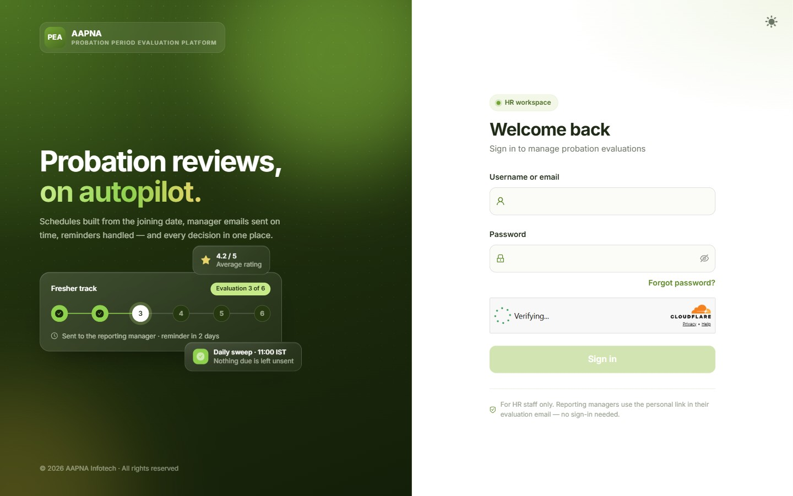
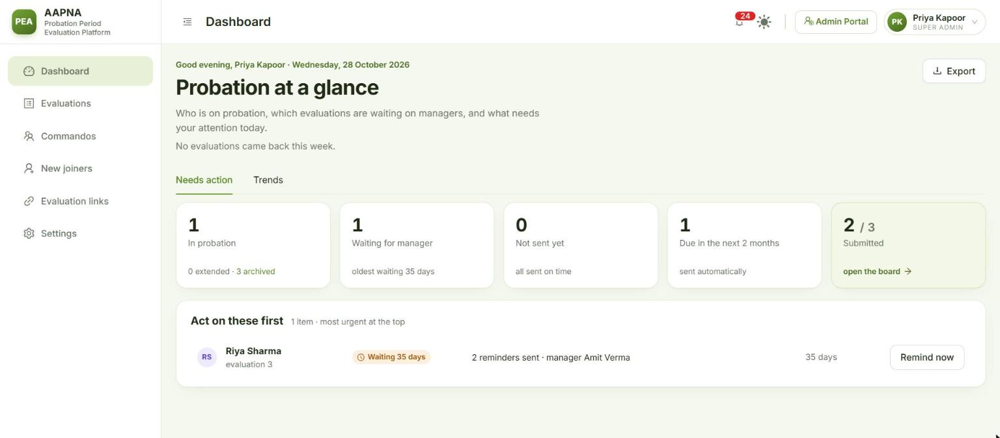
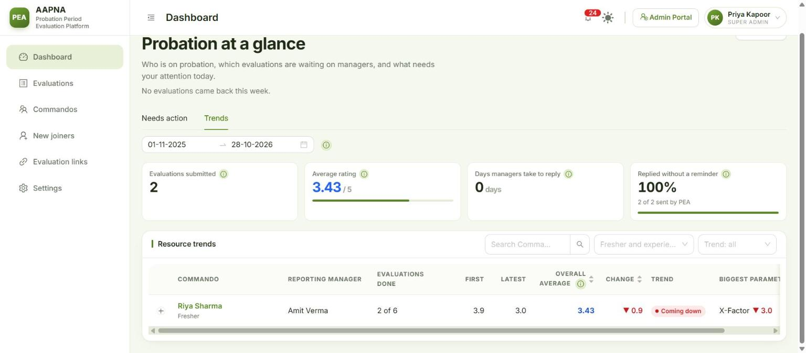
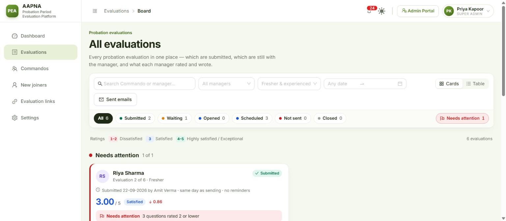
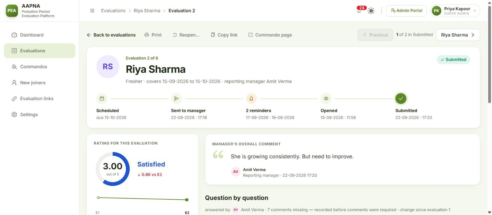
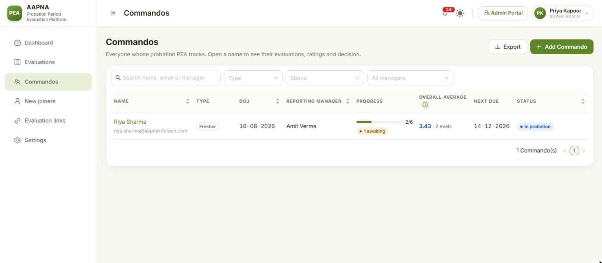
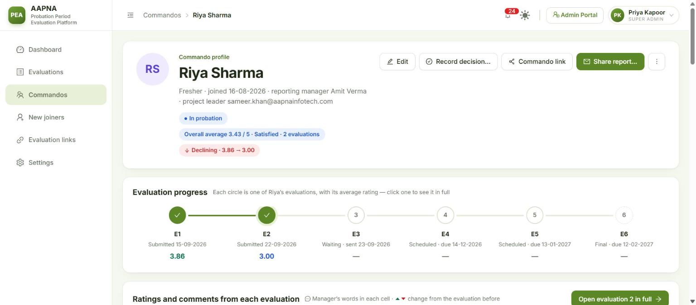
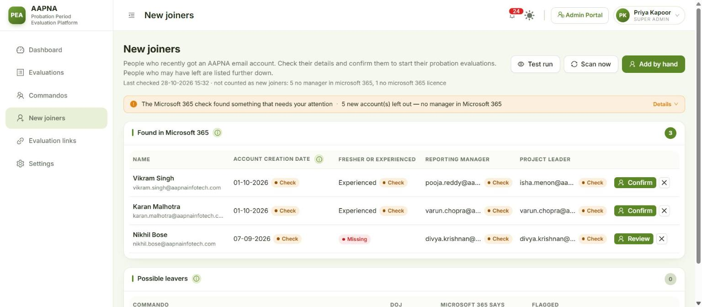
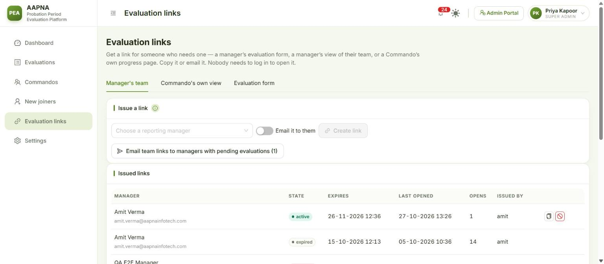

# HR guide

**For:** the HR team who run probation evaluations in PEA every day. **Version:** October 2026.

PEA does most of the work on its own: it sends every evaluation on its due date, sends the reminders, and tells you when a manager has answered. Your job is to keep the people and dates right, read what managers say, act on anything flagged, and make sure every probation ends with a decision.

What you see depends on the screens an admin has switched on for you. If a screen in this guide is missing from your sidebar, ask an admin (see the [Admin guide](02-ADMIN-GUIDE.md)).

**Contents**
1. [Signing in and finding your way](#1-signing-in-and-finding-your-way)
2. [Dashboard](#2-dashboard)
3. [Evaluations](#3-evaluations)
4. [One evaluation](#4-one-evaluation)
5. [Commandos](#5-commandos)
6. [A Commando's page](#6-a-commandos-page)
7. [Recording a decision](#7-recording-a-decision)
8. [New joiners](#8-new-joiners)
9. [Evaluation links](#9-evaluation-links)
10. [Settings, Upload Excel and Email templates (read-only for HR)](#10-settings-upload-excel-and-email-templates-read-only-for-hr)
11. [Notifications](#11-notifications)
12. [Common tasks, step by step](#12-common-tasks-step-by-step)

---

## 1. Signing in and finding your way
- Open PEA in your browser and sign in with your **username or email** and **password**. Complete the security check under the password if it is shown.
- Forgot your password? Click **Forgot password?**, enter your email, and follow the link PEA emails you.
- After signing in you land on the first screen you have access to, usually the **Dashboard**.

**The sidebar** lists your screens: **Dashboard**, **Evaluations**, **Commandos**, **New joiners**, **Evaluation links** and **Settings**. The arrow at the top of the bar hides or shows it.

**The top bar**, right side:

| Item | What it does |
|---|---|
| **No email is being sent** (only when there is a problem) | PEA cannot send email right now. Hover to see why, and tell an admin |
| Bell | Your notifications (section 11) |
| Sun / moon | Light or dark screen |
| **Admin Portal** | Admins only |
| Your name | **Change Password** and **Logout** |

Every date in PEA is written **day-month-year**, for example 28-10-2026.

## 2. Dashboard
**Probation at a glance**: who is on probation, which evaluations are waiting on managers, and what needs your attention today. Under the heading, one line says how many evaluations came back this week and how many you still need to read.

**The five tiles.** Each one opens exactly the people behind its number.

| Tile | Counts | Opens |
|---|---|---|
| **In probation** | Everyone still on probation, including extended. The small line shows how many are extended and how many are archived | Commandos, filtered to "In probation (incl. extended)" |
| **Waiting for manager** | Evaluations emailed to a manager and not yet submitted, opened or not. The small line shows the oldest wait | The Evaluations board, those evaluations only |
| **Not sent yet** | Evaluations past their due date that have not gone out. Should be 0 | The board, "Not sent" |
| **Due in the next 2 months** | Evaluations coming up. They are sent automatically | The board, "Scheduled", up to the same day |
| **Submitted** | Submitted out of all evaluations | The board, "Submitted" |

**Act on these first** is your to-do list, most urgent at the top:

| You see | What it means | Button |
|---|---|---|
| A red pill such as **Not confirmed**, **Low rating** | Submitted feedback that needs a read | **Read feedback** opens the evaluation. Once you have read it, the row goes from **your** list (not from your colleagues') |
| **Probation extended** (orange) | The manager extended the probation | **Read feedback** |
| **Deadline passed** | The probation's decision deadline has passed and no decision is recorded | Opens the Commando, so you can chase or record it |
| **Not sent yet** | An evaluation could not be sent (for example a missing email address) | Opens the record to fix |
| **Waiting** | A manager has had the link for a while | **Remind now** emails them again with the link they already have |

When the list is empty it says **Nothing needs attention right now.**

**Trends tab** (beside **Needs action**) shows how each Commando's ratings change over time:
- Pick a date range at the top. The four figures cover that range: **Evaluations submitted**, **Average rating**, **Days managers take to reply**, and **Replied without a reminder**.
- Below them, one row per Commando: their **First** and **Latest** average, the **Change**, a **Trend** (Growing, Coming down, Steady) and the **Biggest parameter drop**. Open a row to see every question, evaluation by evaluation. Filter by name, by fresher/experienced, or by trend.

**Export** (top right) downloads a snapshot of everything in the old master workbook layout. It changes nothing.

## 3. Evaluations
**All evaluations**: every probation evaluation in one place, which are submitted, which are still with the manager, and what each manager rated and wrote.

**Narrow the list first, then pick a status.**
1. Filters: **Search Commando or manager**, **All managers**, **Fresher & experienced**, and a date range.
2. Status chips: **All**, **Submitted**, **Waiting**, **Opened**, **Scheduled**, **Not sent**, **Closed** and **Needs attention**, each with its count. Hover over a chip to see what it means.
3. The ratings key under the chips: red 1–2, blue 3, green 4–5.

**Cards or Table** (switch at the right of the filters):
- **Cards** (the default) shows three groups: the evaluations that **need attention**, the ones **recently submitted**, and the ones **still in progress**. **Show all** opens the full group. A submitted card shows the average, the decision if there is one, and the manager's overall comment. A card that is still waiting shows who has the link and for how long, with **Remind now**.
- **Table** is for working through many at once. Tick the evaluations you want and click **Remind now** to email each manager again. Rows with a red or orange flag need attention; hover over the flag to see why.

Click any card or row to open that evaluation.

> **Needs attention** means: the manager did not confirm, or extended the probation, the average is below 2.5, or any question was rated 2 or lower. An evaluation leaves this list when someone on HR records what was done about it (section 4).

Admins also see a **Sent emails** button here (see the [Admin guide](02-ADMIN-GUIDE.md)).

## 4. One evaluation
The evaluation page shows one manager's answer for one period.

**At the top:** the Commando, which evaluation it is ("Evaluation 6 of 6 · final evaluation"), the period it covers, the reporting manager, its status, and a timeline (scheduled → sent → reminders → opened → submitted).

**Buttons along the top:**

| Button | Does |
|---|---|
| **Back to evaluations** | Back to the board, with your filters kept |
| **Print** | A clean printed record of this evaluation, without the buttons and menus |
| **Reopen…** | Sends a submitted evaluation back to the manager to correct (below) |
| **Copy link** | A link to this page for someone on the HR team. They need to sign in |
| **Commando page** | Opens the Commando |
| **Previous / Next** | Walks through the evaluations of the list you came from, one by one |

**Left side:**
- **Rating for this evaluation**: the average, its word ("Satisfied"), the change since the last evaluation, a small chart of all their evaluations, and the Commando's overall average.
- **Confirmation decision** (final evaluation only): what the manager decided and their reason. After an extension it also shows when the next evaluation is scheduled.
- **Needs attention** with the reasons. Click **Record what was done**, choose what happened and add a note (required for "other"). The evaluation then leaves "Needs attention" for the whole HR team, and the card shows who dealt with it and when.

**Right side:** the manager's overall comment, then every question with its rating and comment.

**If nothing has come back yet,** the left side says where the form is:

| Situation | What you can do |
|---|---|
| With the manager (waiting or opened) | **Remind now**: emails them again with the same link. **Copy link**: the manager's own form link, if you want to send it on Teams. Copying never replaces their link |
| **Not sent yet** or **Scheduled** | **Send now** (it names the manager and who is copied before it sends). If the manager's or project leader's email is missing you see **Fix details** instead, which opens the Commando |
| The manager is away | **Send to someone else…**: pick an acting manager by name (from Microsoft 365). This one evaluation goes to them, the reporting manager is copied, and any link already sent stops working. The next evaluation goes back to the reporting manager. Add an optional note for the record |
| The manager answered outside PEA, or never will | **Enter ratings…**: type in a rating for every question (comments optional) on the manager's behalf. It is recorded as "entered by HR". No email is sent and the manager's link stops working. **Copy from evaluation N** fills in last time's answers as a starting point |

**Reopen a submitted evaluation** when the manager made a mistake:
1. Click **Reopen…** and type the reason. The manager sees it in the email.
2. Click **Reopen and send back**. The manager gets the form again with their answers filled in, so they change only what is wrong.
3. What they submitted before is kept under **Earlier versions**, with your reason. Any decision it carried is taken back until they submit again.

If an evaluation cannot be reopened, the button is greyed out and hovering over it says why.

**Imported from Excel:** an evaluation brought in from the old sheet may have only some ratings, or only an average. The page says so, and **Add missing ratings…** lets you fill in the rest. No email is sent.

## 5. Commandos
**Commandos**: everyone whose probation PEA tracks.

- **Search** by name, email or manager. Filter by **Type** (fresher or experienced), **Status** and manager.
- **Status** options: In probation, Extended, Confirmed, Not Confirmed, Paused, Held (may have left), Left, Archived, and In probation (incl. extended).
- Columns: name, type, date of joining, reporting manager, **Progress** (evaluations submitted out of the total, and how many are awaiting the manager), **Overall average** (this Commando's own average), **Next due** and **Status**. Click a column heading to sort.
- **Export** downloads the list as you see it (same filters, same order) as an Excel file.
- Archived Commandos are hidden unless you choose **Status → Archived**.

**Add a Commando by hand** (for anyone PEA cannot find in Microsoft 365, or who joined some time ago):
1. Click **Add Commando**.
2. Fill in **Full name**, **Office email**, **Date of joining**, and switch **Experienced** on if they are not a fresher.
3. **Reporting manager**: start typing a name and pick the person from Microsoft 365. Their email is filled in and the project leader is suggested. You can also type both by hand.
4. Check the **Project leader email**.
5. PEA shows how many evaluations will be scheduled, with their dates. If the date of joining is in the past, some may already be due (see [Past-due evaluations](#past-due-evaluations) below).
6. Click **Add and schedule**.

### Past-due evaluations
When you add someone, confirm a joiner, or resume someone after a hold, some evaluations may already be past their due date. PEA asks what to do with them before anything is sent:

| Choice | What happens |
|---|---|
| **Ask the manager for the latest one only** (default when there are several) | The manager gets one form, for the most recent period. The older ones are closed as history |
| **Keep them blank** | Closed as history. Nothing is sent until the next due date |
| **I will enter the ratings myself** | Closed for now. Open each one and use **Enter ratings…** |
| **Ask the manager for all of them** | Every past-due form goes at the next daily send |

## 6. A Commando's page
Click a name anywhere in PEA to open their page.

**At the top:** fresher or experienced, date of joining, reporting manager and project leader, and pills for the status (In probation, Confirmed, Probation extended…), **Decision due** (when the probation has ended with no decision), their **Overall average**, a trend (Improving, Declining) and **On hold** or **Held — may have left** if that applies.

**Buttons:**

| Button | Does |
|---|---|
| **Edit** | Change their details (below) |
| **Record decision…** | Section 7 |
| **Commando link** | A personal link for the Commando to see their own probation. PEA does not email it; copy it and send it yourself. It shows the dates and status plus as much as Settings → Access allows (by default, their averages and the decision) |
| **Share report…** | Emails the full evaluation record to whoever asked for it, with an Excel file attached. Type the **To** address (any @aapnainfotech.com address). The reporting manager and project leader are suggested in **CC**; remove anyone who should not see it. Add a note if you like. Only possible once at least one evaluation is submitted |
| **More** (⋯) | **Download report (.xlsx)**, **Mark as left…** (or **Mark as active again…**), **Hold for long leave** / **Resume evaluations** (only when switched on in Settings), **Archive…** (once the probation is over), and for admins **Delete…** |

**Below the header:**
- **Evaluation progress**: one circle per evaluation, in order, with its status, date and average. Click one to open that evaluation.
- **Ratings and comments from each evaluation**: every question, evaluation by evaluation, with the manager's words and the change from the evaluation before.
- **Details and evaluation dates**: their details, the probation progress (decision, overall average, probation end, next evaluation due, how many are waiting on the manager or overdue), and the **evaluation schedule**. Each row shows the period, due date, status, average, submitted date and how many reminders were sent. Expand a row to read the ratings and comments. **Send** / **Resend** sends that evaluation now; the confirmation names the manager and who is copied.
- **Notes**: HR's own notes on this Commando. Only signed-in PEA users see them, never the Commando or the manager, and they are never in a shared report. A note cannot be edited; whoever wrote it, or an admin, can delete it.
- **Change history**: every change to the record, who made it, from where, and when.

**Editing details.** Click **Edit** to change the name, emails, date of joining, fresher/experienced, reporting manager or project leader.
- Changing the **date of joining** or **fresher/experienced** recalculates the evaluations not yet sent. Ones already sent keep their dates.
- Changing the **reporting manager** moves any open evaluation link to the new manager. PEA tells you how many will move before you save.
- Some values come from **Microsoft 365** (marked on the page). When you change one, PEA asks:
  - **Keep my value**: Microsoft 365 will never overwrite it. It shows a lock, and **Unlock** puts it back under Microsoft 365.
  - **Just this once**: saved now, but a later check may put the Microsoft 365 value back.
- If Microsoft 365 itself is wrong, use **Report to IT** beside that value: give the correct value and a note, and PEA emails IT.

**When someone leaves:** **More → Mark as left…**, give the last working day and a reason. Open evaluations close at once, links already with the manager stop working, and no more emails go. The history is kept. (Usually PEA spots leavers itself; see section 8.)

**Archive:** PEA archives a Commando the morning after their probation is decided or they leave. Archived people leave the Commandos list, the board, the Dashboard, Trends and their manager's team page; their record stays, read-only. Find them with **Commandos → Status → Archived**, and **Restore** brings them back.

## 7. Recording a decision
Normally the **manager** decides on the final evaluation form. Record it yourself when the manager is unavailable, or to correct a decision.

1. Open the Commando and click **Record decision…**.
2. Choose one:

| Decision | What happens |
|---|---|
| **Confirmed** | They are permanent. Open evaluations are closed |
| **Not Confirmed** | The probation ends without confirming. Open evaluations are closed |
| **Extend for 1 month** | One more evaluation, 30 days after the last one |
| **Extend for 2 months** | Two more, 30 and 60 days after the last one |
| **Back to in probation** (only if a decision is recorded) | Clears the decision. An extension evaluation not yet sent is withdrawn |

3. Give a **Reason**: required for everything except Confirmed. It goes on the record and in the change history.
4. Pick the **Decision date** (today or earlier) and click **Record decision**.

A probation can never run past **8 months**. After one extension only "Extend for 1 month" is left; after two, only Confirmed or Not Confirmed. The dialog says so.

The decision deadline is **6 months** after joining (**8** once extended). Past it, the Commando shows **Decision due** and appears on the Dashboard under **Deadline passed**.

## 8. New joiners
**New joiners**: people who recently got an AAPNA email account. Check their details and confirm them to start their probation.

PEA checks Microsoft 365 by itself every day (09:00 by default). The line under the heading says when it last checked and who it left out. When it finds new joiners, the HR review mailbox (**hr2@aapnainfotech.com**) gets an email listing them, with **Confirm** and **Not confirm** buttons beside each one (see [For managers and Commandos](04-MANAGERS-AND-COMMANDOS.md#7-the-hr-review-mailbox-hr2)). You can confirm there in a few seconds, or here.

**Buttons:**

| Button | Does |
|---|---|
| **Test run** | Shows what a check would find right now. Changes nothing and sends nothing |
| **Scan now** | Runs the daily check now. New accounts are added to the list, and if there are new joiners the admins and HR are emailed and the bell rings. No email goes to any manager or Commando |
| **Add by hand** | For someone the check cannot pick up: no manager in Microsoft 365, a different email domain, or an account created before they joined |

Anything that needs you (for example, joiners left out because Microsoft 365 has no manager for them) is listed in the strip under the buttons.

**Found in Microsoft 365** lists each waiting account: name and email, **Account creation date** (the date IT created the Microsoft 365 account), **Fresher or experienced** (suggested from the designation when it can be), **Reporting manager** and **Project leader**.

**Confirm a joiner:**
1. Click **Confirm** (or **Review** if something is missing; hover to see what).
2. Check every field. Two always need a person, because Microsoft 365 does not hold them:
   - **Evaluations counted from**: prefilled with the day after the account was created. Change it if they started on another day. A wrong date moves every evaluation.
   - **Fresher or experienced**: this decides the whole schedule (6 monthly or 3 two-monthly evaluations).
3. Check the reporting manager and project leader (pick by name to fill the email).
4. If evaluations are already past due, choose what to do with them ([Past-due evaluations](#past-due-evaluations)).
5. Click **Add and schedule**. They are now a Commando with their evaluations scheduled.

**Dismiss** (the ✕) removes an account that is not a new joiner (a shared mailbox, a test account). It does not come back on later checks.

**Possible leavers** lists Commandos whose Microsoft 365 account is both **disabled** and **unlicensed**. Their evaluation emails stop on their own as soon as they are flagged. Then:
- **They left**: confirms the exit. All outstanding evaluations stop.
- **Still here**: clears the flag and evaluations carry on.

## 9. Evaluation links
**Evaluation links**: get a link for someone who needs one. Nobody needs to sign in to open it.

| Tab | Use it to |
|---|---|
| **Manager's team** | Give a reporting manager their "my team" page: everyone who reports to them, every evaluation and its status, and a button to open any form waiting for them. Choose the manager, switch **Email it to them** on or off, and click **Create and email** or **Create link**. A new link stops the manager's previous one. Links last 30 days. **Email team links to managers with pending evaluations** does it for every manager with someone on probation, after showing you the list. **Issued links** shows each link's state (active, expired, revoked), when it was last opened, and lets you **Revoke** or copy it |
| **Commando's own view** | The same as **Commando link** on a Commando's page. Choose the Commando and click **Create link**. The line at the top says what Commandos currently see |
| **Evaluation form** | Explains where form links are: they are created when an evaluation falls due. To copy or resend one, open the evaluation and use **Copy link**, so you share the link the manager already has |

## 10. Settings, Upload Excel and Email templates (read-only for HR)
**Settings** has these tabs: **Email**, **Evaluations**, **Probation**, **New joiners**, **Access**, **Upload Excel** and **Email templates** (you see only the ones switched on for you).
- HR can **read** every setting, to check for example who is copied on evaluation emails or when reminders go. Only an admin can change them; the page says "Read-only".
- **Email templates** shows the wording of every email PEA sends, with a preview. Read-only for HR.
- **Upload Excel** lets you download the template, **Check file** and do a **Trial import** to see what an import would do. The final **Import** is for admins.

What each setting does is in the [Admin guide](02-ADMIN-GUIDE.md#4-settings).

## 11. Notifications
The bell in the top bar collects what happened while you were away: an evaluation submitted, a probation not confirmed or extended, new joiners waiting, possible leavers, a deadline passed, a setting changed.
- Click an item to open the evaluation, the Commando or New joiners.
- What you have read is yours: reading an item does not clear it for anyone else.

## 12. Common tasks, step by step

**A manager says they never got the form**
1. Open the evaluation (Evaluations → search the name).
2. Check the status and timeline: when was it sent, was it opened?
3. **Remind now** to email it again, or **Copy link** and send it to them on Teams.
4. If it shows **Not sent yet**, the reason is on the page (often a missing or wrong email). **Fix details**, then **Send now**.
5. An admin can confirm in **Sent emails** that the email went out.

**The manager is on leave**
Open the evaluation → **Send to someone else…** → pick the acting manager → **Send**.

**A manager rated the wrong person or made a mistake**
Open the evaluation → **Reopen…** → give the reason → **Reopen and send back**.

**Someone joined but is not in New joiners**
Check the strip on New joiners (they may have been left out for having no manager in Microsoft 365, in which case ask IT to set one). If it cannot wait, **Add by hand**.

**A leader asks "how is this person doing?"**
Open the Commando → **Share report…** → type their address → **Send report**. Or **More → Download report (.xlsx)** to share it in Teams.

**Someone is going on long leave**
Ask an admin to switch on **Show the manual pause button** (Settings → New joiners), then **More → Hold for long leave**. When they return, **More → Resume evaluations** and choose what to do with anything that fell due meanwhile.

**The probation ended and nobody decided**
The Commando shows **Decision due** and the Dashboard shows **Deadline passed**. Ask the manager, then **Record decision…**.
