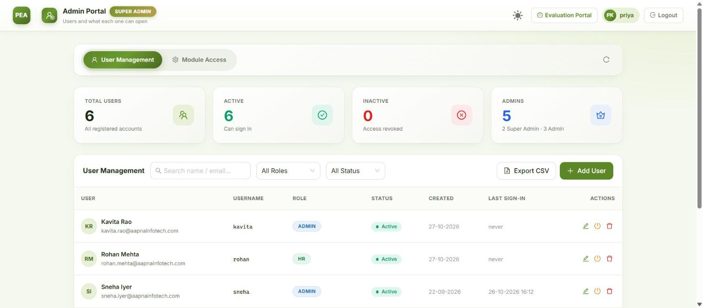
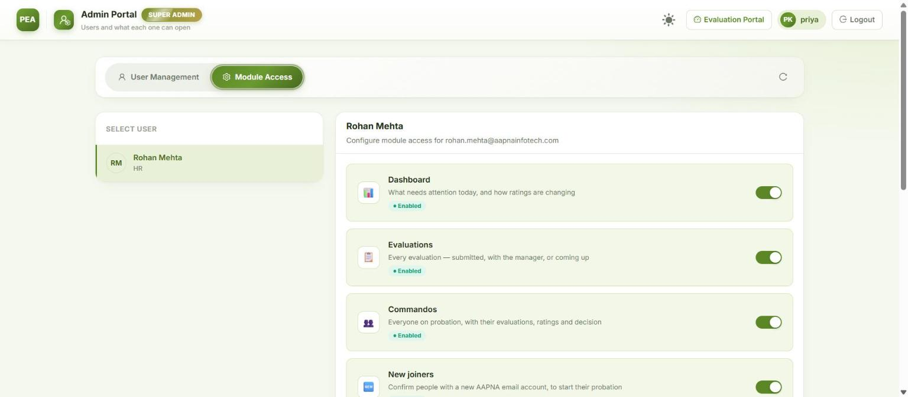
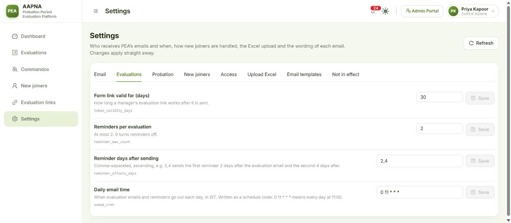
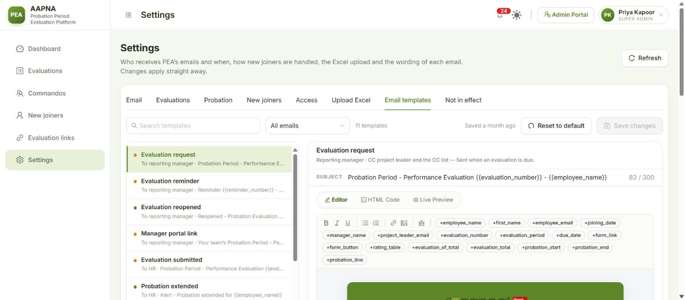
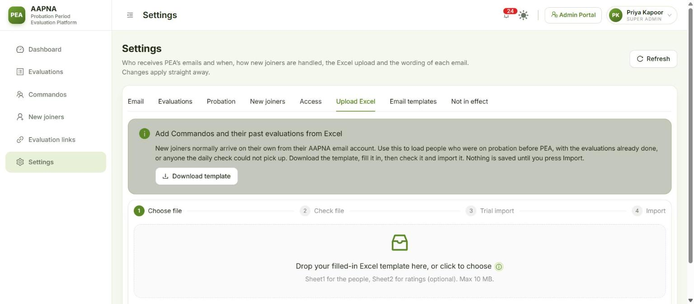
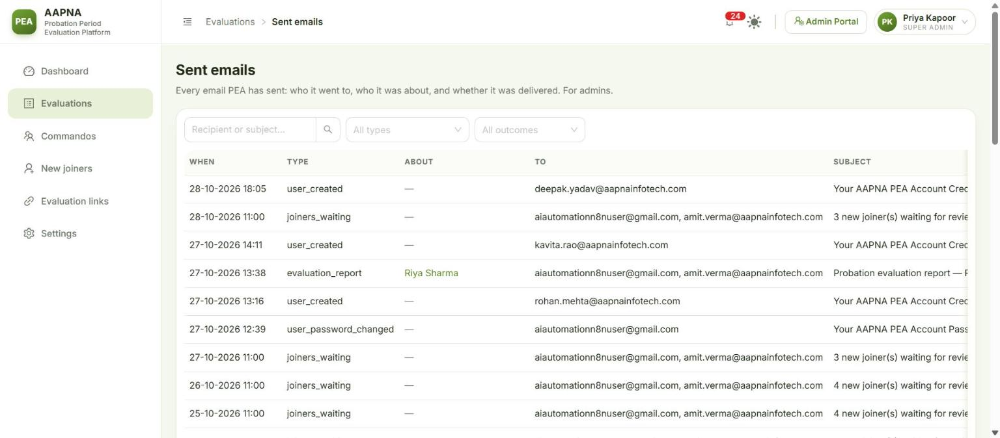

# Admin guide

**For:** PEA admins. **Version:** October 2026.

As an admin you can do everything an HR user can (see the [HR guide](01-HR-GUIDE.md)), on every screen, whatever module access says. You also:
- look after the **HR accounts** and decide which screens each HR user sees;
- **change settings** and **email templates**;
- run the **Excel import**;
- read **Sent emails**, the log of every email PEA has sent;
- **delete** a Commando created by mistake.

Super Admins (see the [Super Admin guide](03-SUPERADMIN-GUIDE.md)) also look after admins.

**Contents**
1. [Opening the Admin Portal](#1-opening-the-admin-portal)
2. [Users](#2-users)
3. [Module access: who sees which screens](#3-module-access-who-sees-which-screens)
4. [Settings](#4-settings)
5. [Email templates](#5-email-templates)
6. [Upload Excel](#6-upload-excel)
7. [Sent emails](#7-sent-emails)
8. [Deleting a Commando](#8-deleting-a-commando)
9. [Housekeeping checklist](#9-housekeeping-checklist)

---

## 1. Opening the Admin Portal
Click **Admin Portal** in the top bar. It has two tabs, **User Management** and **Module Access**, and a refresh button. **Evaluation Portal** (top right) takes you back to PEA, and **Logout** signs you out.

## 2. Users
**User Management** shows counts (**Total Users**, **Active**, **Inactive**, **Admins**) and the list of accounts with their username, role, status, created date and last sign-in. Search by name or email, and filter by role and status. **Export CSV** downloads every account.

**Add a user**
1. Click **Add User**.
2. Fill in **First Name**, **Last Name** and **Email Address**. **Username** is optional; left blank, they sign in with their email.
3. Choose the **Role**. As an admin you can create **Admin** and **HR** accounts.
4. Type a **Password** (at least 10 characters, not containing their name) and confirm it, or click **Auto-Generate Password** and **Copy** it.
5. Click **Create User**. PEA emails the sign-in details to the person's own inbox. If that email could not be sent, PEA says so; give them the password yourself.

**Change a user:** the pencil icon. Change the name, username, role or **Account Status**. To reset their password, type a **New Password** (blank keeps the current one). Changing the role or password, or deactivating, signs them out everywhere at once.

**Deactivate rather than delete.** The power icon deactivates: they are signed out immediately and cannot sign in until reactivated. Their history stays. Only a Super Admin can delete an account.

**What you can't do (by design):**

| Rule | Why |
|---|---|
| You can't change your own role or status | Nobody can lock themselves in or out by mistake |
| You can't edit, reset or deactivate another admin | Admins are peers; a Super Admin manages admins |
| You can't change a Super Admin's account | Only Super Admins can |
| You change your own password from the menu under your name | Not from User Management |

## 3. Module access: who sees which screens
**Module Access**: pick an HR user on the left, then switch each screen on or off for them. Changes save as you click (**✓ Auto-saved**) and reach the person within a minute.

| Module | Screen |
|---|---|
| Dashboard | The Dashboard (Needs action) |
| Evaluations | The Evaluations board and each evaluation's page |
| Commandos | The Commandos list and each Commando's page, Commando links |
| New joiners | New joiners: the Microsoft 365 check, confirming joiners, possible leavers |
| Evaluation links | Manager team links and Commando links |
| Settings | The settings tabs (read-only for HR) |
| ↳ Trends | The Trends tab inside the Dashboard |
| ↳ Upload Excel | The Upload Excel tab inside Settings |
| ↳ Email templates | The Email templates tab inside Settings (read-only for HR) |

- **Settings** shows in the sidebar if any one of Settings, Upload Excel or Email templates is on; the user sees only the tabs that are on.
- Admins and Super Admins always see everything. The switches apply to HR users only.
- **Admin Portal access** is not a switch: make the person an Admin to give it.
- An HR user with every module off sees "No modules are enabled for your account".

## 4. Settings
**Settings** is read-only for HR; only admins can change it. Each setting saves on its own, applies straight away, and needs no restart. Changes to the important ones (marked as such) are announced to every admin through the bell.

### Email
| Setting | What it does |
|---|---|
| **Pause all email** | Normally **off**. On (emergency only): nothing leaves PEA; emails are logged as "would have sent". The top bar then shows **No email is being sent** to everyone |
| **CC on evaluation emails** | Copied on every evaluation request and reminder, alongside the project leader |
| **HR notification recipients** | Receive "evaluation submitted", "probation extended", and the deadline digest |
| **"Report to IT" recipients** | Where **Report to IT** corrections go. Needed before Report to IT works in production |
| **Never copy these as project leader** | People not to copy just because they are listed as project leader (they are still copied if they are the manager or on the CC list) |
| **Copy HR on manager team-link emails** | On: a manager's "my team" email is copied to HR and the CC list |

### Evaluations
| Setting | Default | What it does |
|---|---|---|
| **Form link valid for (days)** | 30 | How long a manager's form link works after it is sent |
| **Reminders per evaluation** | 2 | At most 2; 0 turns reminders off |
| **Reminder days after sending** | 2,4 | First reminder 2 days after the evaluation email, the second 4 days after |
| **Daily email time** | 0 11 * * * (11:00 IST) | When evaluation emails and reminders go out each day. `0 11 * * *` means every day at 11:00; `30 10 * * *` would be 10:30 |

### Probation
| Setting | Default | What it does |
|---|---|---|
| **Archive Commandos this many days after the probation ends** | 0 | 0 = the morning after the decision or exit |
| **Confirmation deadline (months)** | 6 | A decision must be recorded this many months after joining |
| **Deadline once extended (months)** | 8 | The same after an extension |
| **Email HR a daily deadline digest** | | On: HR is emailed daily about probations whose decision is overdue. The Dashboard and bell show them either way |

### New joiners
| Setting | What it does |
|---|---|
| **Nightly Microsoft 365 check** / **Daily Microsoft 365 check time** | Whether the daily check runs, and when (09:00 IST by default, two hours before the evaluation emails). **Scan now** works either way |
| **Look back for new accounts (days)** | How far back the check looks for new accounts (45 by default) |
| **Joiner email domains** | Only accounts on these domains are joiners (aapnainfotech.com, mera.work, karyakeeper.com) |
| **Contractor list** / **Leaders list** | The Microsoft 365 groups used to leave contract staff out and to suggest each joiner's project leader. Change only if IT changes the groups |
| **Never offer these as joiners** / **System mailboxes** | Addresses the check always leaves out |
| **New accounts with no manager in Microsoft 365** | **leave_out**: they wait until IT sets a manager (the screen names them). **show**: they appear with the manager marked "Missing" |
| **Designation words that suggest Fresher / Experienced** | Words in the job title that pre-select the track. Only a suggestion; HR always confirms |
| **Send the new joiner review email to** | **hr2@aapnainfotech.com** by default. The daily "new joiners waiting" email goes only here, with Confirm / Not confirm buttons. Anyone who can read this mailbox can confirm a joiner, so keep it to the HR mailbox. Blank: it goes to every admin and HR user, without buttons |
| **Let the scan update names and emails** | Overwrites unlocked names and office emails with Microsoft 365's. Do a **Test run** first |
| **Hold evaluations when Microsoft 365 says someone has left** | On (default): evaluations stop the moment an account is disabled and unlicensed, before HR confirms |
| **Email HR when the Microsoft 365 check goes wrong** | On (default): HR is told once about each problem (check failed, joiner with no manager) |
| **Show the manual pause button** | Off by default. Switch on for long leave (sabbatical, maternity), when the account stays active |

### Access
| Setting | What it does |
|---|---|
| **Manager portal link valid for (days)** | How long a manager's "my team" link works (30 by default). A new link revokes the previous one |
| **Commando self-view** | What a Commando sees through their own link: **off** (the link does not open), **schedule** (dates and status), **averages** (plus their averages and the decision; the default) or **full** (plus every rating and the manager's comments) |

## 5. Email templates
**Settings → Email templates** lists every email PEA sends. Filter by **To reporting manager**, **To HR** or **To IT**.

| Email | Goes to |
|---|---|
| Evaluation request | Reporting manager · CC project leader and the CC list |
| Evaluation reminder | Reporting manager · CC project leader and the CC list |
| Evaluation reopened | Whoever submitted it · CC project leader and the CC list |
| Manager portal link | Reporting manager |
| Evaluation submitted | HR notification recipients |
| Probation extended | HR notification recipients |
| Confirmation deadline digest | HR notification recipients (when switched on) |
| Evaluation report shared | Whoever HR sends it to |
| Microsoft 365 check alert | HR notification recipients |
| New joiners waiting for review | The review mailbox (hr2@) |
| Report to IT | "Report to IT" recipients · CC HR |

**To change one:**
1. Pick the email from the list (or search for it). Edit the **Subject** and the body in **Editor** (or **HTML Code** if you know HTML).
2. Insert the details PEA fills in (the Commando's name, the due date, the form button…) with the **+** buttons above the editor, such as **+employee_name** or **+form_button**. In the text they appear in double braces, `{{employee_name}}`; keep them exactly as written.
3. Check **Live Preview**, which fills the email with sample data. PEA refuses to save an email that has lost a required link (for example the form button on an evaluation request), or that uses an unknown placeholder.
4. Click **Save changes**. The AAPNA logo, green header and footer are added automatically.

**Reset to default** brings back the original wording. A wrong template goes to every manager who receives that email, so always check the preview first.

## 6. Upload Excel
**Settings → Upload Excel** adds Commandos and their past evaluations from Excel. It is for loading history, and for people the Microsoft 365 check cannot pick up. Nothing is saved until the last step.

1. **Download template**, fill it in (Sheet1: one row per Commando; Sheet2, optional: the ratings). The old master workbook works too.
2. **Choose file** (.xlsx, .xls or .xlsm, up to 10 MB).
3. **Check file** reads every row and shows: rows read, ready, **refused** (with the reason for each), freshers and experienced, already decided, decision needed, and **which managers will be emailed** an evaluation at the next daily send. Fix refused rows in the file and check again.
4. **Trial import** goes through the whole import without saving: how many would be added, how many are already in PEA, and anything that would fail.
5. **Import** (admins only) asks you to confirm, then adds the Commandos with their evaluations and ratings.

Good to know:
- Anyone whose office email is already in PEA is **skipped, not changed**.
- An evaluation due in the last 45 days and not completed in the sheet is emailed to the manager at the next daily send. Anything due earlier is closed as history.
- Someone whose probation is already over with no decision in the sheet is imported as still on probation, with **Decision due** on their page. Record the decision there, or fill in Confirmation Status in the sheet first.
- HR users with Upload Excel switched on can check a file and do a trial import, but not import.

## 7. Sent emails
**Evaluations → Sent emails** (admins only) lists every email PEA has sent: **When**, **Type**, **About** (the Commando), **To**, **Subject** and **Outcome** (sent, failed, or would have sent while email was paused). Search by recipient or subject, and filter by type and outcome. Use it to check that a manager really was emailed.

## 8. Deleting a Commando
Only for demo and test records, or someone added by mistake. **More → Delete…** on the Commando's page, type their full name to confirm, and **Delete permanently**. Every evaluation, rating and the change history go with them, and other admins are notified.

If the person really left, use **More → Mark as left…** instead, which keeps their history.

## 9. Housekeeping checklist
Monthly, or when the HR team changes:
- [ ] People who left the HR team: **deactivate** their PEA account.
- [ ] New HR team members: create an **HR** account and set their **module access**.
- [ ] Dashboard → **Not sent yet** is 0. If not, open each one and fix it.
- [ ] Dashboard → **Act on these first**: nothing old left under **Deadline passed**.
- [ ] New joiners: nobody waiting for more than a few days, and **Possible leavers** dealt with.
- [ ] Settings → Email: the CC list and HR notification recipients are still the right people.
- [ ] **Pause all email** is off and the top bar does not say "No email is being sent".
