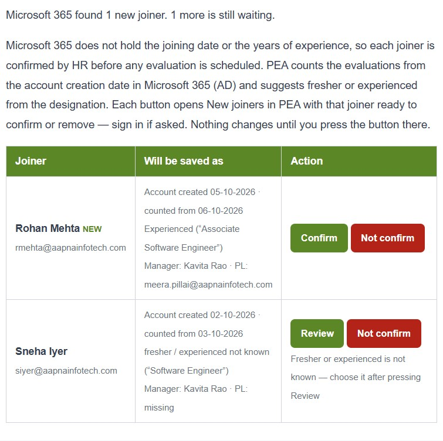

# Super Admin guide

**For:** Super Admins of AAPNA PEA. **Version:** 3, October 2026.

A Super Admin can do everything an Admin can (see the [Admin guide](02-ADMIN-GUIDE.md)), plus:
- create and manage **admins** and other **Super Admins**;
- **delete** accounts;
- see the **Not in effect** tab in Settings.

**Contents**
1. [Managing admins and Super Admins](#1-managing-admins-and-super-admins)
2. [Deleting an account](#2-deleting-an-account)
3. [Not in effect](#3-not-in-effect)
4. [The new joiner review email (hr2@)](#4-the-new-joiner-review-email-hr2)
5. [Good practice](#5-good-practice)

---

## 1. Managing admins and Super Admins
In **Admin Portal → User Management**:

| You can | Notes |
|---|---|
| Create accounts of any role, including **Super Admin** | The **Role** list offers Super Admin to you only |
| Edit admins and HR users: details, role, status, password | Changing the role or password, or deactivating, signs them out everywhere at once |
| Edit another Super Admin's details, role and status | **Not their password**: only they can change it. To stop a Super Admin's access, deactivate the account |
| **Delete** an account | The only role that can (section 2) |

You can't change your own role or status, or delete yourself.

**The last active Super Admin** cannot be demoted, deactivated or deleted. Make someone else a Super Admin first.

## 2. Deleting an account
The bin icon in User Management. It is permanent: the account, its module access and its notifications go. **Deactivate instead** if the person may come back, or if you want to keep a record of who they were.

## 3. Not in effect
**Settings → Not in effect** (Super Admins only) lists old settings that no longer change anything in PEA. They are kept only for reference. The right-hand column says where to make that change now. You don't need to do anything on this tab.

## 4. The new joiner review email (hr2@)
When the Microsoft 365 check finds new joiners, and once a day at the daily email time while anyone is still waiting, PEA emails **hr2@aapnainfotech.com**. The email has a row per joiner: their name and email, what will be saved (account creation date, the date evaluations are counted from, fresher or experienced, manager, project leader), and two buttons.

| Button | What happens |
|---|---|
| **Confirm** | Opens PEA on **New joiners** with this joiner's **Confirm** window already open and filled in. Check the details, then click **Add and schedule**: the person becomes a Commando and their evaluations are scheduled |
| **Review** (instead of Confirm) | Something must be filled in or chosen first. The line under the buttons says what, such as "Fresher or experienced is not known", or evaluations already past due. Opens the same **Confirm** window: fill in what is missing, then click **Add and schedule** |
| **Not confirm** | Opens PEA on **New joiners** with this joiner's row highlighted and **Remove from the inbox?** already open on it. Click **OK** to remove the account from the list. Use it for accounts that are not new joiners. No evaluation is scheduled, and the account does not come back unless its Microsoft 365 account changes |

- If you are not signed in to PEA, it asks you to sign in first, then opens the joiner straight away.
- The buttons never act on their own: they only open PEA. Nothing is saved until you click **Add and schedule** or **OK**. **Cancel** leaves the joiner waiting.
- Reading the hr2@ mailbox is not enough: you need a PEA account, as an Admin, a Super Admin, or an HR user with **New joiners** switched on. A forwarded email gives nobody access.
- PEA records who acted. A confirmed joiner's change history names you and says "Opened from the review email".
- If the joiner is no longer waiting (someone has already confirmed or removed them), PEA opens **New joiners** and says who did it, and when.
- Who receives this email is set in **Settings → New joiners → Send the new joiner review email to** (see the [Admin guide](02-ADMIN-GUIDE.md), section 4).

## 5. Good practice
- Keep at least **two** Super Admins, so one can manage the other's account.
- Give Super Admin only to the people who look after PEA. Admin is enough for day-to-day user management and settings.
- Deactivate before you delete.
- Look at **Sent emails** and the Dashboard's **Not sent yet** tile once a week: an email that keeps failing is worth a message to the PEA team.
