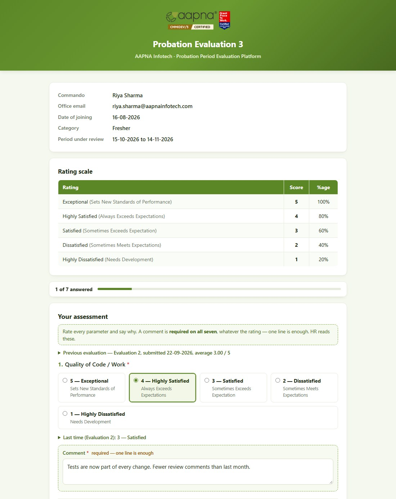
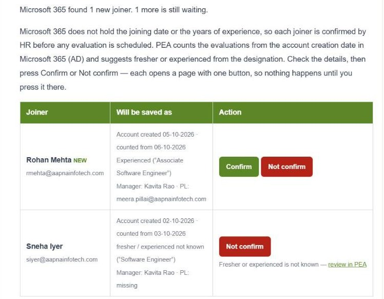

# For managers and Commandos

**For:** reporting managers, acting managers, project leaders, Commandos, the people who read the HR review mailbox, and HR answering their questions. **Version:** October 2026.

You don't need a PEA account. Everything starts from a link in an email. In production every PEA email comes from **hr2@aapnainfotech.com**. Each link is personal and works for a limited time, so don't forward it.

**Contents**
1. [Reporting managers](#1-reporting-managers)
2. [Filling in the evaluation form](#2-filling-in-the-evaluation-form)
3. [The final evaluation: the confirmation decision](#3-the-final-evaluation-the-confirmation-decision)
4. [Your team page](#4-your-team-page)
5. [Acting managers and project leaders](#5-acting-managers-and-project-leaders)
6. [Commandos](#6-commandos)
7. [The HR review mailbox (hr2@)](#7-the-hr-review-mailbox-hr2)
8. [When a link does not open](#8-when-a-link-does-not-open)

---

## 1. Reporting managers
You evaluate each person who reports to you during their probation: **6 times** for a fresher (every 30 days) and **3 times** for an experienced hire (every 60 days).

| Email | What to do |
|---|---|
| **The evaluation email** (the subject names the evaluation and the person) | Click **Open evaluation form** and fill it in (section 2). The email shows the period you are rating and the rating scale |
| **Reminder 1 / Reminder 2** (same subject, starting "Reminder") | The form is still waiting. Same link. Reminders come 2 and 4 days after the first email |
| **Reopened** (subject starting "Reopened") | HR has sent a submitted evaluation back to you to correct. The reason is in the email; your earlier answers are filled in, so change only what is wrong |
| **Your team's …** | Your "my team" page link (section 4) |

The form link works for **30 days** after it is sent. If it has expired, ask HR for a fresh one.

## 2. Filling in the evaluation form

1. Check the details at the top: the Commando, their date of joining, fresher or experienced, and the **period under review**.
2. For each of the **seven questions** (Quality of Code / Work, Meeting Deadline, Communication & Presentation, Proactiveness, Skill Development, Cultural Fit, X-Factor):
   - choose a rating from **1 — Highly Dissatisfied** to **5 — Exceptional**;
   - write a **comment**. A comment is required on every question, whatever the rating; one line is enough. Specific examples help the person improve.
   - From the second evaluation on, **Last time** under each question shows what you rated before, so you can rate progress.
3. Add **Overall remarks** if you like (optional).
4. Click **Submit evaluation**. The bar at the top shows how many questions you have answered.

- **Your work is saved as you go.** The form saves a draft a few seconds after each change, and **Save draft** saves it now. You can close the page and finish later, even on another device, from the same link.
- If something is missing, the form lists it at the top and marks the question. Nothing you typed is lost.
- The form can be submitted **once**. Please check before you submit. If you made a mistake afterwards, ask HR to reopen it.
- After submitting you see **Evaluation Submitted**. You can close the tab.

## 3. The final evaluation: the confirmation decision
The last evaluation of the probation also asks for a **confirmation decision**:

| Choice | What happens |
|---|---|
| **Confirm** | The person is made permanent. No further evaluations |
| **Do not confirm** | The probation ends without confirming. No further evaluations |
| **Extend by 1 month** | One more evaluation, one month from now |
| **Extend by 2 months** | Two more evaluations, one and two months from now |

- For anything other than **Confirm**, give a **reason**: what would need to change for the person to be confirmed. HR sees it with your ratings, and it goes on the person's record.
- A probation can never run past **8 months**, so after an extension fewer choices are offered. The form says so.

## 4. Your team page
HR can send you a link to a page showing **everyone who reports to you** in PEA:
- each person's type (fresher or experienced), joining date, and the decision once made;
- every evaluation with its period, due date, status and **your average**;
- an **Open form** button beside any evaluation waiting for you.

The top of the page shows how many evaluations are waiting for you and until when the link works (30 days). A new link from HR replaces the old one.

## 5. Acting managers and project leaders
**Acting managers.** If the reporting manager is away, HR may send **one** evaluation to you instead. You get the same email and form; the reporting manager is copied. The next evaluation goes back to the reporting manager.

**Project leaders** are copied on every evaluation email and reminder for their Commandos. Nothing is needed from you; it keeps you informed.

## 6. Commandos
HR can share a personal link to **your own probation page**. It shows:
- your evaluations, their periods, due dates and status (**Scheduled**, **With your manager**, **Submitted**, **Closed**);
- depending on what HR has chosen, your **average** for each evaluation and the final decision, and possibly your manager's ratings and comments.

The link is personal to you. It works until the date shown at the bottom of the page, and stops working if you leave AAPNA. Questions about what you see: speak to HR.

## 7. The HR review mailbox (hr2@)
When PEA finds new joiners in Microsoft 365, it emails **hr2@aapnainfotech.com** (daily, while anyone is waiting) with a row per joiner: their name and email, what will be saved (account creation date, the date evaluations are counted from, fresher or experienced, manager, project leader), and two buttons.

| Button | What happens |
|---|---|
| **Confirm** | Opens a page showing exactly what will be saved. Click **Confirm and schedule evaluations**: the person becomes a Commando and their evaluations are scheduled |
| **Not confirm** | Opens a page; click **Not confirm — remove from the inbox**. Use it for accounts that are not new joiners. No evaluation is scheduled, and the account does not come back |
| **… — review in PEA** (instead of Confirm) | Something needs a choice first, such as fresher or experienced not known, or evaluations already past due. Open **New joiners** in PEA and confirm there |

- The buttons never act on their own: each opens a page, and only the button on that page saves.
- Links work for **72 hours**, and only while the joiner is still waiting. If the details changed since the email, Confirm refuses and sends you to PEA.
- Anyone who can read this mailbox can confirm a joiner. Keep access to the HR team.

## 8. When a link does not open

| Page | Means | What to do |
|---|---|---|
| **Evaluation Already Submitted** | The form was already submitted | Nothing. If it needs correcting, ask HR to reopen it |
| **Evaluation Link Expired** | The link is past its time limit | Ask HR for a fresh link |
| **Evaluation On Hold** | HR has paused this person's evaluations | Nothing for now |
| **Evaluation Link Inactive** | The link was replaced (for example HR resent it, or sent it to an acting manager) or is no longer needed | Use the latest email, or ask HR |
| **This link cannot be opened** (team or Commando page) | The link has expired or been replaced | Ask HR for a new one |
